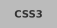

<h1 align="center">
  

   

  
</h1>

  
  
  
  

---

## 👤 About Me

Student specializing in **Artificial Intelligence**.
Passionate about networks, cybersecurity, server infrastructure, and building things...

- 🖥️ Running my own **self-built physical server** at [arqone.eu](https://arqone.eu) - Ubuntu Server, Nginx, Cloudflare, Pterodactyl...
- 🐍 **Python** developer - automation, Discord bots, scripting, data tools...
- 🌐 **Networking** - DNS, reverse proxy, self-hosting; Cisco Networking Academy: CCNA Introduction to Networks (course 1 of 3)
- 🖨️ **3D printing** hobbyist
- 🔒 **Arch Linux** daily driver (btw)
- 🤖 Experimenting with things

---

## 🛠️ Tech Stack

**Languages**

  
  
  
  
  

**Infrastructure & Networking**

  
  
  
  
  
  

**Tools**

  
  
  
  
  

---

## 🚀 Projects

**[arqone.eu](https://arqone.eu)** - Personal server infrastructure & portfolio *(in development since 2024)*
> Self-built physical server · Ubuntu Server · Nginx reverse proxy · Cloudflare DNS & SSL · Pterodactyl game panel · Discord community

**[Arqone Frostline](https://arqone.eu/projects/frostline)** - Whitelisted modded Minecraft server *(completed)*
> Full server management, modpack creation & configuration, community management

**Python & Discord bots** - [github.com/kexe-dev](https://github.com/kexe-dev)
> Automation scripts, Discord bots for community management, self-hosted AI tooling experiments

...and a lot more!

---

## 🏅 Certifications

- 📡 **Cisco Networking Academy: CCNA Introduction to Networks** - (course 1 of 3)
- 🇬🇧 **Cambridge B1 Preliminary (PET), Grade A** - certified at B2

---

## 📊 GitHub Stats

  

  

---

## ⏱️ WakaTime Stats

  

---

## 📈 Contribution Graph

  

---

  

